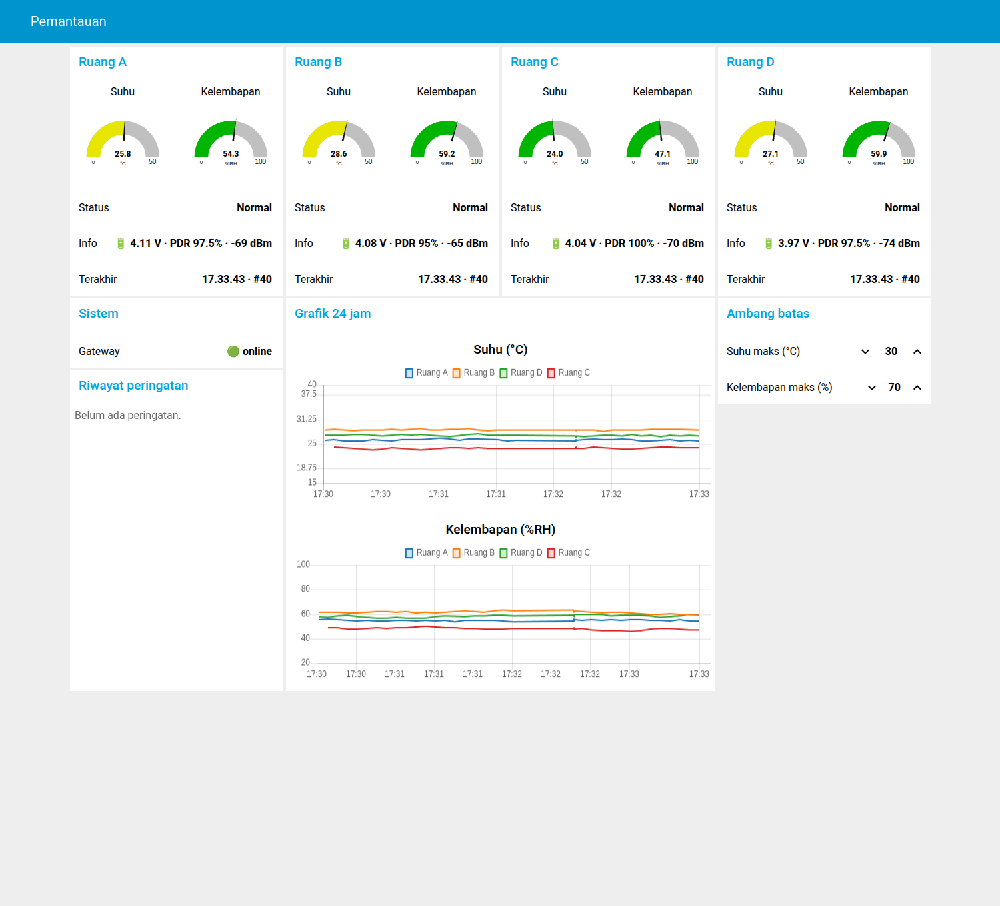
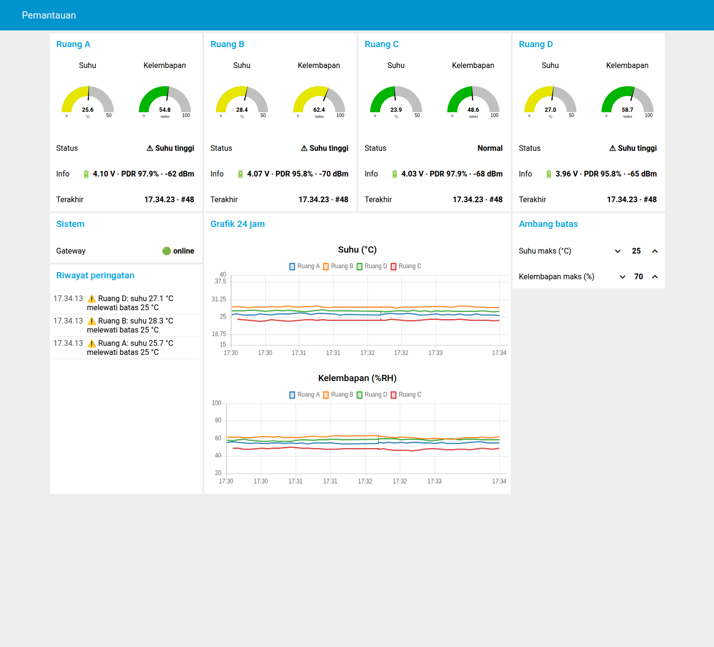
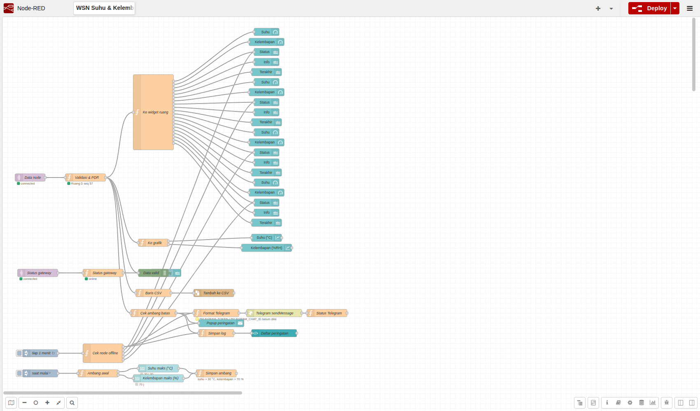
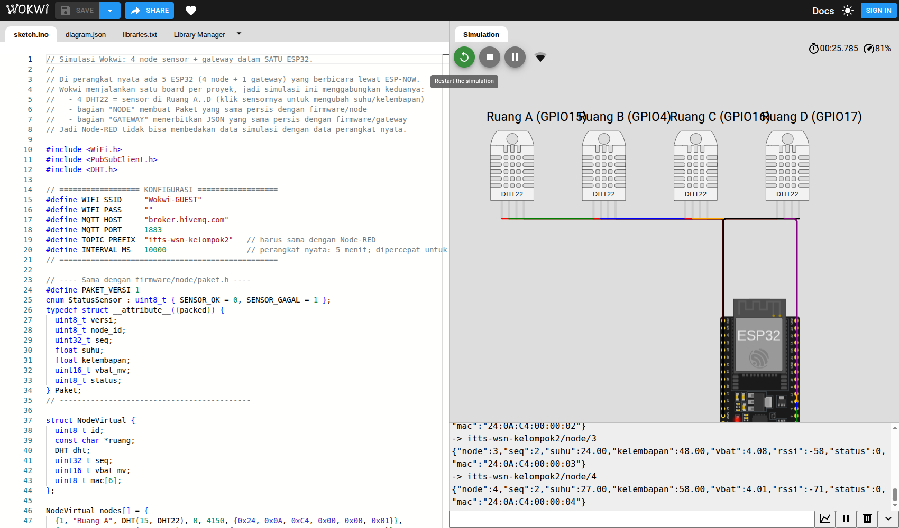

# Sistem Pemantauan Suhu dan Kelembapan Ruangan Berbasis WSN

Tugas Proyek Jaringan Sensor Nirkabel, Fakultas Ilmu Komputer, Institut Teknologi Tangerang Selatan, Tahun 2026/2027.

Dosen: Koko Oktavianus Asmara

### Kelompok 2

| Nama | NIM |
|---|---|
| Muhammad Farid Zaki | 1003240010 |
| Anggoro Jati Pratikto | 1003240026 |
| Lintang Arif Setianda | 1003240023 |
| Muhammad Elbra Herlambang | 1003250036 |
| Ikbar Rabbani Purwanto | 1003240029 |

Empat node sensor (ESP32 + DHT22) di Ruang A sampai D mengirim data lewat ESP-NOW ke satu gateway ESP32 (topologi star). Gateway meneruskan data ke MQTT broker. Node-RED menampilkan dashboard, menyimpan riwayat ke CSV, dan mengirim peringatan Telegram.

```
Node 1..4 (ESP32+DHT22) --ESP-NOW--> Gateway ESP32 --MQTT--> broker --> Node-RED --> Dashboard / CSV / Telegram
```

Simulasi Wokwi: https://wokwi.com/projects/480570078977605633



| Peringatan | Flow Node-RED | Wokwi |
|---|---|---|
|  |  |  |

## Isi repo

| Folder | Isi |
|---|---|
| `firmware/node/` | Firmware node sensor: baca DHT22, kirim ESP-NOW dengan ACK, deep sleep 5 menit |
| `firmware/gateway/` | Firmware gateway: terima ESP-NOW, terbitkan ke MQTT |
| `wokwi/` | Simulasi Wokwi: 1 ESP32 + 4 DHT22 yang meniru 4 node dan gateway |
| `node-red/` | Flow Node-RED (`flows.json`), simulator lokal, dependensi |
| `start.sh` / `start.bat` | Menjalankan semuanya dengan satu klik |

## Jalankan dengan satu klik

Syarat: [Node.js](https://nodejs.org) versi 20 atau lebih baru.

- **Windows:** klik dua kali `start.bat`.
- **Linux/macOS:** jalankan `./start.sh`.

Skrip ini:

1. Memasang Node-RED dan dashboard saat pertama kali dijalankan.
2. Menjalankan Node-RED dan membuka dashboard di http://localhost:1880/ui/ (editor ada di http://localhost:1880/).
3. Membuka proyek Wokwi jika `wokwi/wokwi-url.txt` sudah berisi link. Jika belum, skrip memakai simulator lokal (`node-red/simulator.mjs`).

| Perintah | Simulasi |
|---|---|
| `start.bat` / `./start.sh` | Wokwi jika link ada, selain itu simulator lokal |
| `... --lokal` | Selalu simulator lokal |
| `... --tanpa-sim` | Tanpa simulasi, data dari perangkat ESP32 nyata |

Variabel simulator lokal: `INTERVAL_DETIK=2` (lebih cepat), `PANAS=B` (Ruang B dibuat panas untuk menguji peringatan) dan `PELUANG_HILANG=0.1` (10% paket hilang untuk menguji PDR).

## Menyiapkan Wokwi (sekali saja)

1. Buka https://wokwi.com/projects/new/esp32 lalu login.
2. Ganti isi `sketch.ino` dan `diagram.json` dengan file dari folder `wokwi/`.
3. Tambahkan file `libraries.txt` (tombol **+** di samping tab file), lalu salin isinya dari `wokwi/libraries.txt`.
4. Klik **Save**. Salin link proyek (misalnya `https://wokwi.com/projects/4123...`) ke baris kosong di `wokwi/wokwi-url.txt`.
5. Jalankan `start.bat` atau `./start.sh`, lalu tekan tombol Play hijau di Wokwi.

Klik salah satu DHT22 di Wokwi untuk mengubah suhu dan kelembapan. Naikkan suhu di atas 30 °C untuk melihat peringatan. Interval kirim di simulasi adalah 10 detik, sedangkan perangkat nyata mengirim tiap 5 menit.

Wokwi menjalankan satu board per proyek. Karena itu simulasi menggabungkan 4 node dan gateway dalam satu ESP32. Format paket dan JSON-nya sama persis dengan firmware nyata.

## Dashboard Node-RED

- Gauge suhu dan kelembapan per ruang, status, baterai, PDR, RSSI, dan waktu data terakhir.
- Grafik suhu dan kelembapan 4 ruang (24 jam terakhir).
- Ambang batas yang bisa diubah dari dashboard. Nilai awal sesuai proposal: suhu > 30 °C, kelembapan > 70%.
- Riwayat peringatan dan popup di dashboard.
- Status gateway (online/offline lewat MQTT Last Will).
- Deteksi node offline: tidak ada data lebih dari 12 menit (2 paket berturut-turut hilang).
- Riwayat pengukuran disimpan ke `node-red/riwayat-pengukuran.csv`. Kolomnya: `waktu_iso,node,ruang,suhu,kelembapan,vbat,rssi,seq,pdr`.

Peringatan dikirim hanya saat kondisi berubah (normal ke melewati batas, atau sebaliknya), dengan histeresis 0,5 °C / 2%. Dengan begitu Telegram tidak menerima pesan setiap 5 menit.

### Telegram

1. Buat bot lewat @BotFather dan salin tokennya.
2. Kirim pesan ke bot, lalu ambil chat id lewat @userinfobot.
3. Salin `.env.example` menjadi `.env`, lalu isi `TELEGRAM_TOKEN` dan `TELEGRAM_CHAT_ID`.
4. Jalankan ulang skrip start.

`.env` tidak ikut di-commit.

### Flow baru kelompok

`node-red/flows-baru.json` adalah flow "WSN Monitoring" buatan kelompok. Isinya 4 grup ruangan, masing-masing dengan gauge suhu, gauge kelembapan dan grafik, ditambah log CSV (`log_wsn.csv`) dan peringatan Telegram. Flow ini sudah disesuaikan agar menerima data dari gateway/Wokwi di repo ini:

- Broker `broker.hivemq.com`, topik `itts-wsn-kelompok2/node/+`. Fungsi "Ubah format gateway" mengubah `{node, suhu, kelembapan}` menjadi `{node_id, temp, hum}`.
- Token dan chat id Telegram dibaca dari `.env`, tidak ditulis di flow.
- Gauge suhu Ruangan 1 sudah tersambung. Di versi awal keluaran ini tidak terhubung.
- Telegram hanya dikirim saat ruangan berubah dari normal ke melewati batas, bukan setiap paket.

Cara menjalankan: `FLOW=flows-baru.json ./start.sh` (Linux/macOS). Di Windows, jalankan `set FLOW=flows-baru.json` lalu `start.bat`. Jalankan salah satu flow saja. Jika keduanya aktif, peringatan Telegram terkirim dua kali.

### PDR (tingkat keberhasilan pengiriman paket)

Setiap node menaikkan nomor urut `seq` (disimpan di memori RTC, tetap ada selama deep sleep). Node-RED menghitung `PDR = paket diterima / (seq terakhir − seq pertama + 1)`. Paket duplikat (dikirim ulang karena ACK hilang) tidak dihitung. Jika `seq` turun, node dianggap restart dan hitungan dimulai ulang.

## Perangkat nyata

### Rangkaian node

| DHT22 / komponen | ESP32 |
|---|---|
| VCC | GPIO25 (sensor dimatikan saat tidur) |
| DATA | GPIO4 (+ pull-up 10 kΩ ke 3V3 jika modul tanpa resistor) |
| GND | GND |
| Baterai 18650 + | Regulator 3,3 V, lalu pin 3V3 |
| Baterai 18650 + | Pembagi 100 kΩ / 100 kΩ ke GPIO34 (baca tegangan) |

### Langkah

1. Arduino IDE: pasang board **esp32** (Espressif). Pasang library **DHT sensor library**, **Adafruit Unified Sensor**, dan **PubSubClient**.
2. **Gateway:** salin `firmware/gateway/config.example.h` menjadi `config.h` lalu isi Wi-Fi dan broker. Upload `gateway.ino`. Catat `MAC gateway: ...` dari Serial Monitor.
3. **Node:** di `firmware/node/node.ino`, isi `GATEWAY_MAC` dengan MAC tadi dan atur `NODE_ID` (1 sampai 4). Upload ke setiap node.
4. Jalankan `start.bat --tanpa-sim` atau `./start.sh --tanpa-sim`.

Node mencari kanal Wi-Fi gateway secara otomatis (kanal 1 sampai 13) dan mengingatnya di memori RTC. Router tidak perlu diatur ke kanal tertentu.

### Format data

Topik `itts-wsn-kelompok2/node/<id>`:

```json
{"node":1,"seq":42,"suhu":27.3,"kelembapan":61.2,"vbat":3.95,"rssi":-60,"status":0,"mac":"24:0A:C4:12:34:56"}
```

`status` 1 berarti DHT22 gagal dibaca (`suhu` dan `kelembapan` bernilai `null`). Topik `itts-wsn-kelompok2/gateway/status` berisi `online` atau `offline` (retained).

## Catatan broker

Konfigurasi default memakai broker publik `broker.hivemq.com` agar Wokwi, gateway, dan Node-RED bisa terhubung tanpa server sendiri. Siapa pun bisa membaca topik di broker publik. Jika kelompok lain memakai awalan topik yang sama, ganti `itts-wsn-kelompok2` di keempat tempat berikut:

- `wokwi/sketch.ino`
- `firmware/gateway/config.h`
- `node-red/simulator.mjs` (atau variabel `TOPIC_PREFIX`)
- dua node `mqtt in` di `node-red/flows.json`
